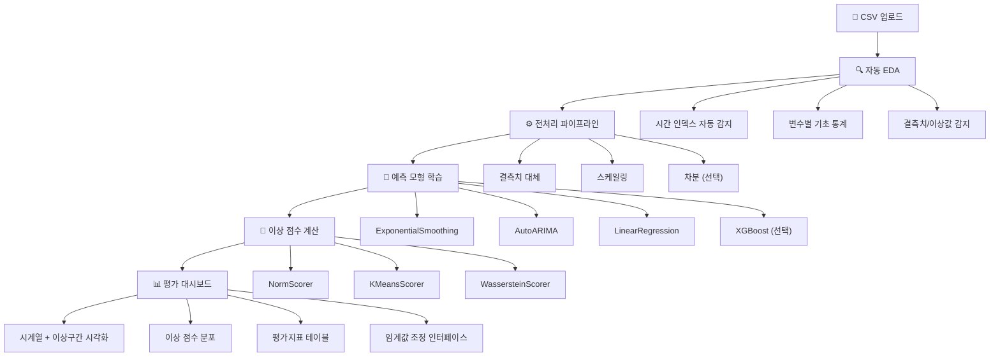
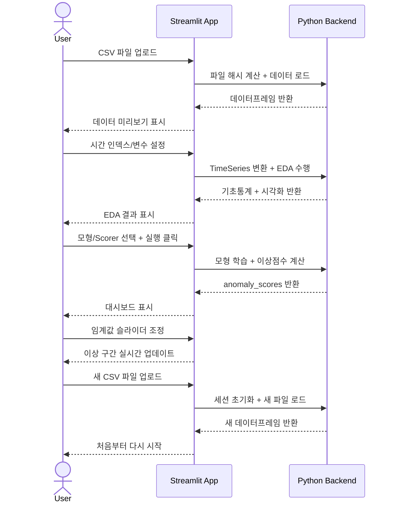

# 시계열 이상탐지 자동화 웹앱 기획서

> **과목**: 시계열 분석  
> **프레임워크**: Streamlit (Python)  
> **핵심 라이브러리**: Darts, pandas, plotly, scikit-learn

---

## 1. 프로젝트 개요

### 1.1 목적
임의의 **다변량 시계열 CSV 파일**을 업로드하면, 자동으로 데이터를 분석하고 **시계열 이상탐지**를 수행하는 인터랙티브 웹 애플리케이션을 개발한다.

### 1.2 핵심 요구사항

| # | 요구사항 | 상세 |
|---|---------|------|
| R1 | CSV 업로드 | 다변량(multivariate) 시계열 CSV 파일 업로드 |
| R2 | 자동 분석 | 업로드 즉시 EDA + 이상탐지 자동 수행 |
| R3 | 파일 변경 대응 | 새 파일 업로드 시 기존 결과 초기화, 새 이상탐지 수립 |
| R4 | 평가 대시보드 | 다양한 평가지표 시각화로 이상 탐지 결과의 적절성 판단 |
| R5 | 라벨 데이터 지원 | 실제 이상 여부 라벨 CSV 업로드 → 지도 평가지표(AUC-ROC 등) 산출 |
| R6 | 배포 | Streamlit Community Cloud에 배포하여 외부에서 접근 가능 |

### 1.3 수업 내용과의 연결

본 기획은 수업에서 다룬 다음 내용을 핵심 백엔드로 활용한다:

- **Darts 이상탐지 모듈**: `ForecastingAnomalyModel`, `NormScorer`, `KMeansScorer`, `WassersteinScorer`
- **예측 모형**: ExponentialSmoothing, AutoARIMA, LinearRegressionModel, XGBModel 등
- **딥러닝 모형** (선택): RNN, LSTM, GRU, Transformer, N-BEATS
- **평가지표**: MAE, MSE, MAPE, AUC-ROC
- **시계열 전처리**: 스케일링, 차분, 결측치 대체, 정상성 검정

---

## 2. 시스템 아키텍처



---

## 3. 페이지 구성 (Streamlit 멀티페이지)

### 3.1 페이지 목록

| 페이지 | 이름 | 설명 |
|--------|------|------|
| 1 | 📁 **데이터 업로드** | CSV 업로드 + 시간 인덱스/변수 설정 + (선택) 라벨 CSV 업로드 |
| 2 | 🔍 **탐색적 분석 (EDA)** | 기초 통계, 시계열 시각화, 정상성 검정 |
| 3 | ⚙️ **이상탐지 설정** | 모형 선택, 파라미터 조정, 학습 수행 |
| 4 | 📊 **결과 대시보드** | 이상 탐지 결과, 평가지표, 시각화 (라벨 유무에 따라 지도/비지도 지표 자동 전환) |

### 3.2 페이지별 상세 설계

---

#### 📁 페이지 1: 데이터 업로드

**기능:**
- `st.file_uploader`로 CSV 파일 업로드
- 파일 변경 감지: 새 파일 업로드 시 `st.session_state` 초기화
- 업로드 후 데이터 미리보기 (상위 10행)

**사용자 설정:**
- 시간 인덱스 컬럼 선택 (드롭다운 또는 자동 감지)
- 시간 형식(날짜/시간/기간) 선택
- 주파수(freq) 자동 감지 또는 수동 설정 (`h`, `D`, `MS`, `min`, `30min` 등)
- 분석 대상 변수 선택 (다중 선택)

**(선택) 라벨 데이터 업로드:**
- `st.file_uploader`로 라벨 CSV 별도 업로드 (실제 이상 여부 0/1)
- 또는 원본 CSV 내 라벨 컬럼을 드롭다운으로 지정
- 라벨 데이터의 시간 인덱스가 원본 시계열과 정렬되는지 자동 검증
- 라벨이 제공되면 페이지 4에서 자동으로 **지도(Supervised) 평가지표**(AUC-ROC, AUC-PR, F1, Confusion Matrix) 활성화
- 라벨 미제공 시 비지도 평가지표만 표시

**자동 처리:**
- `pd.to_datetime()`으로 시간 인덱스 변환
- `pd.infer_freq()`로 주파수 자동 추론
- Darts `TimeSeries.from_dataframe()`으로 변환

**파일 변경 대응 로직:**
```python
# st.session_state를 활용한 파일 변경 감지
if uploaded_file is not None:
    file_hash = hashlib.md5(uploaded_file.getvalue()).hexdigest()
    if st.session_state.get("file_hash") != file_hash:
        # 새 파일 → 세션 초기화
        st.session_state.clear()
        st.session_state["file_hash"] = file_hash
        st.session_state["df"] = pd.read_csv(uploaded_file)
```

---

#### 🔍 페이지 2: 탐색적 분석 (EDA)

**기초 통계 테이블:**
- 변수별: count, mean, std, min, max, 결측치 비율
- `st.dataframe(df.describe().T)`

**시계열 시각화:**
- Plotly `line` 차트: 선택한 변수들의 시계열 시각화
- Plotly `subplots`: 변수별 개별 차트
- 시간 범위 선택 슬라이더

**정상성 검정:**
- ADF 검정 (Augmented Dickey-Fuller): 변수별 p-value + 정상/비정상 판정
- Ljung-Box 검정: 자기상관 존재 여부

**상관관계 분석:**
- 변수 간 상관행렬 히트맵 (Plotly)
- 시차 상관(cross-correlation) 분석

**결측치 시각화:**
- 변수별 결측치 위치를 시간축 위에 시각화
- 결측치 처리 방법 선택: 선형 보간, 이전값 채우기, 삭제

---

#### ⚙️ 페이지 3: 이상탐지 설정

**학습/테스트 분할:**
- 슬라이더로 학습 데이터 비율 설정 (기본: 70%)
- 또는 날짜 기준 분할점 선택

**전처리 옵션:**
- 스케일링: MinMaxScaler / StandardScaler / None
- 차분: 0차(없음), 1차, 2차
- 결측치 처리: 선형보간 / 전방채움 / 삭제

**다변량 처리 방식 (Multivariate Strategy):**

`final.md` / `mid.ipynb`에서 정의된 방식을 1순위로 따른다. 해당 데이터셋(또는 사용자 명시)에 처리 방식이 지정되지 않은 경우 **"동시 고려(Joint)" 방식**을 기본값으로 적용한다.

| 옵션 | 설명 | 적용 시점 |
|------|------|----------|
| `Reproduce (final/mid)` | `final.md`·`mid.ipynb`에 명시된 방식 그대로 수행 (수업 예제 재현) | 데이터셋이 수업 예제와 일치하거나 사용자가 명시적으로 선택 |
| `Joint (동시 고려)` ⭐기본 | 다변량 시계열을 하나의 `TimeSeries`로 묶어 학습 + Scorer를 다변량으로 적합. Scorer별 점수를 `OrAggregator`/`AndAggregator`로 결합하여 하나의 통합 이상 점수 산출 | 처리 방식이 명시되지 않은 모든 경우 |
| `Per-Variable (독립)` | 각 변수를 독립적으로 학습·점수화 후, 변수별 이상 결과를 별도 탭으로 제공 | 사용자가 명시적으로 선택 |

> [!NOTE]
> Darts의 `ForecastingAnomalyModel`은 다변량 `TimeSeries`를 직접 받아 학습이 가능하며, `NormScorer(component_wise=False)`로 다변량을 한 번에 점수화할 수 있다. Joint 모드에서는 이 방식을 활용하고, 복수 Scorer 결합 시 `OrAggregator`를 기본 결합 규칙으로 사용한다.

**예측 모형 선택 (사이드바):**

| 카테고리 | 모형 | 비고 |
|----------|------|------|
| 통계 모형 | ExponentialSmoothing | 추세/계절성 자동 설정 |
| 통계 모형 | AutoARIMA | 최적 차수 자동 탐색 |
| 회귀 모형 | LinearRegressionModel | lags 파라미터 설정 |
| 회귀 모형 | SKLearnModel (Ridge) | lags 파라미터 설정 |
| 트리 모형 | XGBModel | lags + 공변량 지원 |
| 트리 모형 | LightGBMModel | lags + 공변량 지원 |
| 딥러닝 | RNNModel (LSTM/GRU) | ⚠️ GPU 필요, 선택적 |

> [!NOTE]
> 딥러닝 모형은 학습 시간이 길므로, 통계/회귀/트리 모형을 기본으로 제공하고 딥러닝은 "고급 옵션"으로 분리한다.

**이상 점수 산출기(Scorer) 선택:**

| Scorer | 설명 |
|--------|------|
| `NormScorer` | 예측 오차의 절대값(L-norm) 기반 이상 점수 |
| `KMeansScorer(k=2)` | KMeans 클러스터링 기반 이상 점수 |
| `WassersteinScorer` | Wasserstein 거리 기반 이상 점수 |

**파라미터 설정 (Expander):**
- `input_chunk_length` / `lags`: 과거 데이터 사용 기간
- `output_chunk_length`: 예측 기간
- Scorer별 window 크기
- KMeansScorer의 k값

**실행 버튼:**
- "🚀 이상탐지 실행" 버튼 클릭 시 학습 + 점수 계산 수행
- `st.spinner("모형 학습 중...")` + `st.progress()` 진행률 표시
- 결과를 `st.session_state`에 저장

---

#### 📊 페이지 4: 결과 대시보드

**4.1 이상 탐지 결과 시각화**

- **메인 차트**: 원본 시계열 + 이상 구간 하이라이트 (빨간 음영)
  - Darts의 `show_anomalies_from_scores()` 스타일을 Plotly로 재현
  - 변수별 탭으로 분리

- **이상 점수 차트**: Scorer별 이상 점수 시계열
  - 임계값 수평선 표시
  - 임계값 초과 구간 하이라이트

- **임계값 조정 슬라이더**: 
  - 사용자가 임계값을 실시간 조정
  - 임계값 변경 시 이상 구간 즉시 업데이트

**4.2 평가지표 대시보드**

> [!IMPORTANT]
> 라벨 데이터(실제 이상 여부)가 있는 경우와 없는 경우를 구분하여 평가지표를 제공한다.

**Case A: 라벨 데이터 없는 경우 (비지도)**

| 지표 | 설명 | 시각화 |
|------|------|--------|
| 이상 점수 분포 | 점수 히스토그램 + KDE | Plotly histogram |
| 탐지된 이상 수 | 임계값 기준 이상 개수 | KPI 카드 |
| 이상 비율 | 전체 대비 이상 비율(%) | KPI 카드 |
| 이상 점수 통계 | mean, std, max, quantile | 테이블 |
| 예측 성능 | MAE, MSE, MAPE | KPI 카드 |

**Case B: 라벨 데이터 있는 경우 (지도)**

| 지표 | 설명 | 시각화 |
|------|------|--------|
| AUC-ROC | 이상 탐지 분별력 | ROC 커브 |
| AUC-PR | Precision-Recall 곡선 하 면적 | PR 커브 |
| Precision | 탐지된 이상 중 실제 이상 비율 | KPI 카드 |
| Recall | 실제 이상 중 탐지된 비율 | KPI 카드 |
| F1 Score | Precision과 Recall의 조화 평균 | KPI 카드 |
| Confusion Matrix | 4분할 혼동행렬 | 히트맵 |

- 라벨 데이터는 **페이지 1(데이터 업로드)** 에서 사전 등록되며, 본 페이지에서는 자동으로 지도 평가지표를 활성화
- 라벨이 부분 구간만 존재할 경우, 라벨이 있는 구간에 대해서만 지도 지표 계산

**4.3 Scorer 비교**

- 복수 Scorer 선택 시, Scorer별 이상 점수를 오버레이 시각화
- Scorer별 평가지표 비교 테이블
- "최적 Scorer 추천" 기능 (AUC-ROC 기준 자동 랭킹)

**4.4 이상 구간 상세**

- 탐지된 이상 구간 목록 테이블 (시작~종료 시각, 지속시간, 평균 이상 점수)
- 개별 이상 구간 클릭 시 해당 구간 줌인 차트
- CSV 다운로드 버튼: 이상 점수 + 이상 여부 판정 결과

---

## 4. 기술 스택 상세

### 4.1 프로젝트 구조

```
ts_anomaly_app/
├── app.py                    # Streamlit 메인 엔트리포인트
├── pages/
│   ├── 1_📁_데이터_업로드.py
│   ├── 2_🔍_탐색적_분석.py
│   ├── 3_⚙️_이상탐지_설정.py
│   └── 4_📊_결과_대시보드.py
├── utils/
│   ├── data_loader.py        # CSV 로드 + TimeSeries 변환
│   ├── eda.py                # 탐색적 분석 함수들
│   ├── preprocessing.py      # 전처리 파이프라인
│   ├── anomaly_detection.py  # 이상탐지 핵심 로직
│   └── evaluation.py         # 평가지표 계산
├── requirements.txt
└── README.md
```

### 4.2 의존 라이브러리

```
streamlit>=1.30
darts>=0.28
pandas>=2.0
numpy>=1.24
plotly>=5.18
scikit-learn>=1.3
statsmodels>=0.14
```

### 4.3 핵심 백엔드 로직 (`anomaly_detection.py`)

```python
# Darts 기반 이상탐지 파이프라인 (수업 내용 기반)
from darts.ad import ForecastingAnomalyModel, NormScorer, KMeansScorer
from darts.models import SKLearnModel, ExponentialSmoothing, AutoARIMA

def run_anomaly_detection(ts_train, ts_test, model_name, scorer_names, params):
    """
    이상탐지 파이프라인 실행
    
    1. 예측 모형 생성 + 학습
    2. ForecastingAnomalyModel 구성
    3. Scorer 학습 (fit)
    4. 이상 점수 계산 (score)
    """
    # 모형 생성
    forecasting_model = create_model(model_name, params)
    forecasting_model.fit(ts_train)
    
    # Scorer 리스트 생성
    scorers = []
    for name in scorer_names:
        if name == "NormScorer":
            scorers.append(NormScorer())
        elif name == "KMeansScorer":
            scorers.append(KMeansScorer(k=params.get("k", 2)))
        elif name == "WassersteinScorer":
            scorers.append(WassersteinScorer())
    
    # ForecastingAnomalyModel 구성
    anomaly_model = ForecastingAnomalyModel(
        model=forecasting_model,
        scorer=scorers
    )
    
    # Scorer 학습
    anomaly_model.fit(ts_train, allow_model_training=False)
    
    # 이상 점수 계산
    anomaly_scores = anomaly_model.score(ts_test)
    
    return anomaly_scores
```

---

## 5. 세션 상태 관리

파일 변경 시 새로운 이상탐지를 수립하기 위한 `st.session_state` 설계:

```python
# 세션 상태 키 목록
st.session_state = {
    "file_hash": str,           # 현재 파일의 해시값
    "df": pd.DataFrame,         # 원본 데이터프레임
    "ts": TimeSeries,           # Darts TimeSeries 객체
    "ts_train": TimeSeries,     # 학습 데이터
    "ts_test": TimeSeries,      # 테스트 데이터
    "anomaly_scores": list,     # Scorer별 이상 점수 리스트
    "anomaly_model": object,    # 학습된 ForecastingAnomalyModel
    "config": dict,             # 사용자 설정값 (다변량 처리 방식 포함)
    "labels": TimeSeries,       # (선택) 이상 라벨 데이터 (페이지 1에서 업로드)
    "multivariate_mode": str,   # "reproduce" | "joint" | "per_variable"
}
```

> [!TIP]
> `file_hash` 비교를 통해 파일 변경을 감지하고, 변경 시 모든 관련 세션 상태를 초기화하여 새로운 분석 파이프라인을 시작한다.

---

## 6. UI/UX 가이드라인

### 6.1 레이아웃

- **사이드바**: 전역 설정 (파일 정보, 현재 단계 진행 표시)
- **메인 영역**: 페이지별 콘텐츠
- **탭**: 변수별/Scorer별 결과 분리

### 6.2 디자인 원칙

- Plotly 차트의 `template="plotly_dark"` 사용 (다크모드)
- `st.metric()`으로 KPI 카드 배치
- `st.columns()`으로 반응형 그리드 레이아웃
- `st.expander()`로 고급 옵션 숨김 처리

### 6.3 인터랙션 흐름



---

## 7. 샘플 데이터

워크스페이스에 이미 존재하는 `machine_temperature_system_failure.csv` 파일을 기본 데모 데이터로 활용할 수 있다.

- 이 파일은 시계열 이상탐지 벤치마크 데이터로 적합
- 앱 실행 시 "샘플 데이터 사용" 버튼으로 즉시 체험 가능하게 구현

---

## 8. 구현 우선순위 (단계별)

### Phase 1: 핵심 기능 (MVP)
- [x] 기획 완료
- [ ] CSV 업로드 + 시간 인덱스 자동 감지
- [ ] 기초 EDA (시계열 시각화, 기초 통계)
- [ ] 단일 모형(SKLearnModel) + 단일 Scorer(NormScorer) 이상탐지
- [ ] 이상 점수 시각화 + 임계값 슬라이더
- [ ] 파일 변경 시 세션 초기화

### Phase 2: 확장 기능
- [ ] 다중 모형 선택
- [ ] 다중 Scorer 비교
- [ ] **라벨 데이터 업로드 + 지도 평가지표** (AUC-ROC, AUC-PR, F1, Confusion Matrix) — *확정 필수 기능*
- [ ] 이상 구간 상세 목록 + CSV 다운로드
- [ ] 다변량 처리 방식 토글 (`reproduce` / `joint` / `per_variable`)

### Phase 3: 고급 기능
- [ ] **딥러닝 모형 (LSTM, GRU, Transformer, N-BEATS) 지원** — *Phase 3 포함 확정*
  - GPU(`torch.cuda.is_available()`) 자동 감지 후 device 할당
  - CPU 환경에서는 학습 시간 경고 표시
- [ ] 백테스팅 결과 시각화
- [ ] 공변량 자동 생성 (시간 특성)
- [ ] 앙상블 모형 지원

### Phase 4: 배포
- [ ] **Streamlit Community Cloud 배포** — *확정*
  - GitHub 레포지토리 연동
  - `requirements.txt` / `runtime.txt`(Python 3.10) 정리
  - 시크릿/환경변수는 Streamlit Cloud의 Secrets Management 사용
  - 파일 업로드 용량 제한(`server.maxUploadSize`) 200MB로 설정
  - 딥러닝 모형은 Cloud의 CPU 한계로 인해 "고급 옵션"으로 비활성화 가능 토글 제공

---

## 결정 사항 (Resolved Decisions)

> [!IMPORTANT]
> 아래 5개 항목은 사용자와의 협의를 통해 확정되었다. 위 본문은 모두 이 결정사항을 반영한 상태이다.

| # | 질문 | 결정 |
|---|------|------|
| 1 | **딥러닝 모형 포함 시점** | **Phase 3에서 LSTM/GRU/Transformer/N-BEATS 추가**. Phase 1·2는 통계/회귀/트리 모형으로 MVP를 안정화하고, Phase 3에서 RTX 4070 Laptop GPU(`cuda:0`)를 활용하여 딥러닝 모형 학습을 수행. CPU/Cloud 환경에서는 경고 후 비활성화 토글 제공. |
| 2 | **라벨 데이터 지원** | **필수 기능으로 확정**. 페이지 1에서 별도 라벨 CSV 업로드(또는 원본 CSV 컬럼 지정) 지원. 라벨 존재 시 페이지 4 대시보드에서 지도 평가지표(AUC-ROC, AUC-PR, Precision, Recall, F1, Confusion Matrix) 자동 활성화. |
| 3 | **다변량 처리 방식** | **`final.md` / `mid.ipynb`에 명시된 방식을 1순위로 재현**. 데이터셋·옵션에 명시된 방식이 없을 경우 **"동시 고려(Joint)" 방식을 기본값**으로 적용 (다변량 `TimeSeries` 단일 학습 + Scorer를 다변량으로 적합, 복수 Scorer는 `OrAggregator`로 결합). `Per-Variable` 모드는 사용자 선택 옵션으로 제공. |
| 4 | **배포 환경** | **Streamlit Community Cloud 배포 확정**. Phase 4를 신설하여 배포 작업을 분리. GitHub 연동, `requirements.txt` / `runtime.txt`(Python 3.10) 관리, Secrets Management, `server.maxUploadSize=200` 설정. Cloud는 CPU만 제공하므로 딥러닝 모형은 비활성화 토글 노출. |
| 5 | **기획서 상세 수준** | **현재 수준으로 적절**. 구현 단계로 진입하며, 추가 상세화는 각 Phase 진행 중 PR 단위로 보강한다. |
